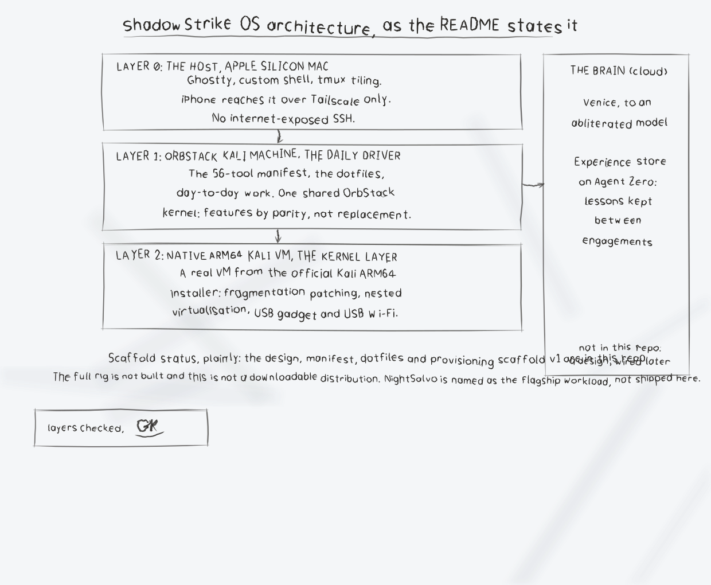

<p align="center">
  
</p>

# ShadowStrike OS

**A reproducible, customised Kali Linux platform for authorised security work, built on an Apple Silicon Mac, designed to be rebuilt from this repository.**

Operator: **Epsilon0xCell**
Mark: the globe-head operator (see `assets/`). Silver is the mark, green is the signal. The static logo is never recoloured, never stretched, and never placed on a light background.

> **Status: in active development.** What exists today is the design, the curated tool manifest, the dotfiles, and the provisioning scaffold (v1) in this repository. The full rig is not yet built, and this is **not** a finished, downloadable distribution. If the machine dies, the platform does not: it is rebuilt from here.

## Authorisation

ShadowStrike OS is only ever used against systems, networks, and accounts the operator owns or is authorised **in writing** to test. No exceptions, no grey areas. Scope is written down before an engagement starts, and the tooling is only pointed inside that scope. If authorisation is unclear, the work does not start.

## Architecture

One platform, three layers, plus a brain that lives in the cloud:

```text
  iPhone ──Tailscale──► Apple Silicon Mac (host)
                              │
                              ├─ Layer 1: OrbStack Kali machine : daily driver
                              └─ Layer 2: native ARM64 Kali VM  : kernel layer
                                        │
  Cloud brain: Venice + abliterated model, experience store on Agent Zero
```

### Layer 0, The host: Apple Silicon Mac

The Mac is the attack box and the only physical machine in the design.

- **Terminal:** Ghostty with a custom shell configuration. Tiling happens in the terminal (tmux sessions and panes), not in a tiling window manager.
- **Remote access:** an iPhone reaches the Mac over **Tailscale** (Blink / Termius), a private mesh link only. There is **no internet-exposed SSH**.
- **Containers and machines first:** day-to-day work runs in OrbStack containers and machines. A heavyweight VM is the exception, not the default.

### Layer 1, The daily driver: OrbStack Kali machine

A customised Kali Linux machine running in OrbStack on ARM64. It carries the terminal workflow, the 56-tool manifest, the dotfiles, and day-to-day engagement work, and it stays light, fast, and disposable by design.

OrbStack runs one shared kernel of its own for every machine, so this layer gets its Kali kernel features by **parity, not by replacement**: `kernel-parity/` holds a read-only audit that measures which features the shared kernel already has, plus an experimental, clearly-labelled route for the one out-of-tree wireless driver the platform misses. Whatever parity cannot deliver is routed to Layer 2, never forced into the daily driver.

### Layer 2, The kernel layer: native ARM64 Kali VM

A real virtual machine from the official Kali Linux ARM64 installer, reserved for kernel work and the small set of jobs containers and parity cannot do:

- fragmentation patching (kernel-level packet fragmentation work),
- nested virtualisation (KVM inside the guest),
- USB gadget functions (the guest acting as a USB device) and USB Wi-Fi work whose drivers must be built against a genuine Kali kernel.

### The brain: cloud models and memory

The host is the hands; the cloud is the brain. Model access runs through **Venice** to an **abliterated model**, and an **experience / memory store on Agent Zero** keeps lessons between engagements, so what one engagement teaches the platform is still there for the next.

### Flagship workload

The platform exists to run the operator's flagship program, **NightSalvo**, an autonomous security-systems program, alongside the curated manual tooling below.

## Tooling: a loadout, not a warehouse

Kali's full install is a warehouse. A flagship platform is a loadout. `tool-manifest.csv` holds **56 tools**, each chosen because it is the current best answer for its job:

| Category | Tools |
| --- | ---: |
| Web | 10 |
| Terminal | 9 |
| Recon | 9 |
| Active Directory | 8 |
| Cloud | 5 |
| Credentials | 5 |
| Reporting | 4 |
| Exploitation frameworks | 3 |
| Post-exploitation | 3 |
| **Total** | **56** |

Highlights: the ProjectDiscovery suite for recon and scanning, NetExec and Certipy for Active Directory, Caido as the intercepting proxy, Prowler for cloud, Sliver as the manual-install C2, and a tight set of terminal staples. Everything else is installed per engagement, recorded in the manifest first, and removed when the engagement closes.

Version pins are only written in the manifest where verified against a tool's public release page. Everything else is marked `UNPINNED`: the provision installs the current release and `sbom.sh` records the exact version that landed. An honest `UNPINNED` beats an invented pin, and the SBOM proves what is actually installed.

## Repository layout

| Path | Purpose |
| --- | --- |
| `provision.sh` | Idempotent provisioning scaffold, run inside a fresh OrbStack Kali machine. Supports `--dry-run`, which prints every action, including every `sudo` call, and changes nothing. |
| `tool-manifest.csv` | The curated 56-tool manifest (category, source, version pin, licence, purpose). |
| `dotfiles/` | zsh, tmux, fastfetch, MOTD, and the prompt fallback note. |
| `assets/` | The organisation logo; wallpaper and lock-screen source. |
| `sbom.sh` | Generates a dated software inventory under `sbom/`. |
| `SNAPSHOTS.md` | Snapshot, export, and backup discipline. Read it before the first provision. |
| `kernel-parity/` | The kernel parity audit and the experimental driver build. |

## Install and current status

The platform is scaffold-first. The intended order, once the rig build runs:

1. **Snapshot the starting point.** Follow `SNAPSHOTS.md`: confirm the machine is listed and healthy before changing anything.
2. **Create the machine** (host): `orb create kali shadowstrike`, then open a shell with `orb -m shadowstrike`.
3. **Copy this repository into the machine** (host): `orb push`, or clone it there.
4. **Dry run first** (inside the machine): `./provision.sh --dry-run` prints every action and changes nothing. Read it.
5. **Provision** (inside the machine): `./provision.sh` installs the `apt` rows of the manifest, deploys the dotfiles (anything replaced is backed up into a timestamped folder under `~/.shadowstrike-backups/`), installs the MOTD and fastfetch configuration, and finishes with the kernel-parity audit.
6. **Install the manual rows.** BloodHound CE, Caido, Sliver, and the other rows marked `manual` in the manifest are installed by hand, following each project's own documentation, then recorded by the next SBOM run.
7. **Generate the SBOM:** `./sbom.sh` writes the dated inventory.
8. **Snapshot again.** A provisioned, inventoried machine is the restore point. See `SNAPSHOTS.md`.

`provision.sh` is idempotent: running it again converges the machine to the manifest instead of stacking changes.

## Roadmap

- Complete the first full provision of the OrbStack daily driver from the v1 scaffold and snapshot it.
- Close out the kernel-parity table; keep the ARM64 VM scoped to kernel, USB, and nested-virtualisation work only.
- Exercise the full remote loop, iPhone over Tailscale into Ghostty on the host, into the daily driver, as the standard way of working.
- Wire the cloud brain and the Agent Zero experience store into the daily workflow, so engagement lessons persist by default.
- Keep the manifest curated: tools enter by decision and leave at engagement close; the SBOM stays the proof.

## Rebuilds and updates

Snapshot before every provision change; run `sbom.sh` and snapshot again after it. The kernel-parity audit is re-run after every OrbStack update, because a shared-kernel update can change the parity table overnight.

## Diagrams and maps

I drew the platform out in [ShadowStrike-OS-Visuals](ShadowStrike-OS-Visuals/): an architecture diagram, a components diagram of the files in this repo, a flowchart of the build order, and a product map, with the written product map, statistics with citations, and the roadmap in [VISUAL.md](ShadowStrike-OS-Visuals/VISUAL.md). Every sheet also ships as a PNG photograph of the paper page beside its SVG.


